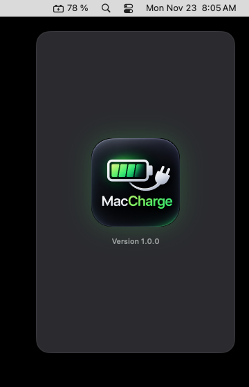
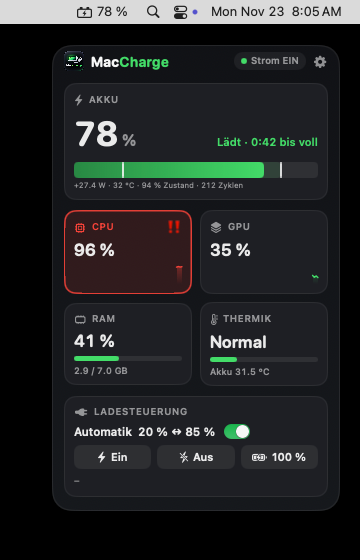

# MacCharge

Kleines, schwebendes Widget für macOS, das Systemwerte anzeigt und das Laden des MacBooks über eine **Refoss-Smart-Steckdose** steuert, standardmäßig zwischen **20 %** und **85 %**. Die App ist komplett kostenlos: keine Cloud, kein Abo, kein Apple-Entwicklerkonto.

 

## Funktionen

| Bereich | Was passiert |
|---|---|
| **Start** | Dunkelgrauer Startbildschirm mit Logo und Versionsnummer, danach wechselt die Ansicht zum Dashboard. |
| **Akku** | Ladestand, Lade-/Entladeleistung (W), Restzeit, Temperatur, Zustand (%), Ladezyklen und ein Balken mit Markierungen für beide Ladegrenzen. |
| **CPU / GPU** | Aktuelle Auslastung mit Verlauf der letzten 2 Minuten. |
| **RAM** | Belegter Speicher in % und GB, berechnet wie in der Aktivitätsanzeige. |
| **Thermik** | Thermischer Zustand von macOS (Normal / Erhöht / Hoch / Kritisch). |
| **Ladesteuerung** | Bei ≥ Obergrenze wird die Steckdose **AUS** geschaltet, bei ≤ Untergrenze **EIN**. Dazwischen wird nicht geschaltet (Hysterese). Ob der Befehl gewirkt hat, prüft die App am Netzteilsignal des Macs. Schlägt das fehl, versucht sie es bis zu 3-mal erneut. |
| **Manuell** | Die Buttons *Ein*, *Aus* und *100 %* (einmalig voll laden). Manuelles Schalten pausiert die Automatik für 30 Minuten. |
| **Warnungen ‼️** | Bei Überlastung färbt sich der betroffene Bereich rot und zeigt ‼️. Das gilt für CPU, GPU, RAM, Akkutemperatur, Thermik und Steckdose. Die Schwellwerte lassen sich einstellen. |
| **Fenster** | Lässt sich frei auf alle angeschlossenen Bildschirme ziehen. Die Position wird gespeichert. Wird ein Monitor abgesteckt, holt die App das Widget automatisch auf den Hauptbildschirm. |
| **Autostart** | Die App startet beim Anmelden automatisch. Das lässt sich in den Einstellungen abschalten. |
| **Updates** | Die App prüft beim Start und danach alle 6 Stunden auf GitHub, ob es eine neue Version gibt. Unter Einstellungen → Updates installierst du sie mit **„Jetzt aktualisieren & neu starten“**. |

Bedienung: Rechtsklick aufs Widget oder Klick auf das Menüleisten-Symbol (⚡︎ + Akkustand) öffnet Einstellungen, Ausblenden, Position zurücksetzen und Beenden.

## Installation

1. Unter [Releases](../../releases) die Datei `MacCharge-x.y.z.zip` herunterladen und entpacken.
2. `MacCharge.app` in den Ordner **Programme** ziehen. Das ist nötig, damit Updates funktionieren.
3. **Beim ersten Start:** Rechtsklick auf die App → **Öffnen** → **Öffnen**. Die App ist nur ad-hoc signiert, weil eine Apple-Notarisierung 99 €/Jahr kostet. Unter macOS 15 und neuer geht es stattdessen über *Systemeinstellungen → Datenschutz & Sicherheit → „Dennoch öffnen“*.

Voraussetzung: macOS 13 (Ventura) oder neuer, Apple Silicon oder Intel.

## Steckdose einrichten

### Variante A: Apple Home über Kurzbefehle (Standard, empfohlen für HomeKit-Modelle)

Funktioniert mit jeder Steckdose, die in der Home-App eingebunden ist.

1. Steckdose über die Refoss-App bzw. die Home-App zu Apple Home hinzufügen.
2. Die App **Kurzbefehle** auf dem Mac öffnen und zwei neue Kurzbefehle anlegen:
   - **„MacCharge Ein“**: Aktion *Zuhause steuern* → Steckdose → *Einschalten*
   - **„MacCharge Aus“**: Aktion *Zuhause steuern* → Steckdose → *Ausschalten*
3. In MacCharge unter Einstellungen → Steckdose → **Verbindung testen** klicken.

### Variante B: Refoss lokal (Open API)

Nur für Refoss-Geräte mit „Open API“ (z. B. **P11S**). Diese Variante liefert zusätzlich die Leistungsaufnahme in Watt.

1. In der Refoss-App die IP-Adresse der Steckdose ablesen. Am besten im Router eine feste IP vergeben.
2. In MacCharge unter Einstellungen → Steckdose die Variante „Refoss lokal“ wählen, die IP eintragen und **Verbindung testen** klicken.

Verwendete Befehle, entnommen der offiziellen [Refoss-Home-Assistant-Integration](https://github.com/refoss/refoss_rpc):
`Switch.Action.Set {id, action: on|off}`, `Refoss.Status.Get` (Werte `output`, `apower`) und `Refoss.DeviceInfo.Get`.

> ⚠️ Nicht jede Refoss-Steckdose hat die Open API. Ältere oder reine HomeKit-Modelle verwenden ein anderes, cloudgebundenes Protokoll. In diesem Fall bitte Variante A nutzen.

## Selbst bauen

```bash
./scripts/build-app.sh          # erzeugt dist/MacCharge.app und dist/MacCharge-<version>.zip
open dist/MacCharge.app
```

Dafür werden Xcode oder die Command Line Tools benötigt (`xcode-select --install`, kostenlos).

## Neue Version veröffentlichen (Updates verteilen)

1. Versionsnummer in `VERSION` erhöhen, z. B. `1.1.0`.
2. Committen und einen Tag pushen:
   ```bash
   git tag v1.1.0 && git push origin v1.1.0
   ```
3. GitHub Actions baut die App auf einem kostenlosen macOS-Runner und veröffentlicht automatisch ein Release mit der ZIP-Datei.
4. Alle installierten MacCharge-Apps zeigen das Update unter Einstellungen → Updates an. Ein grüner Punkt am Zahnrad im Widget weist darauf hin.

## Projektstruktur

```
Sources/MacCharge/
  App/          Einstieg, AppDelegate, Widget-Fenster (Position), Einstellungen, Autostart
  Monitoring/   CPU, GPU, RAM, Akku (IOKit), Überlastungsbewertung
  Charging/     Ladeautomatik, Kurzbefehle-/Refoss-Ansteuerung
  Update/       GitHub-Release-Updater mit Neustart
  Views/        SwiftUI: Splash, Dashboard, Einstellungen
Resources/      Info.plist, Logo, App-Icon
scripts/        build-app.sh
```
